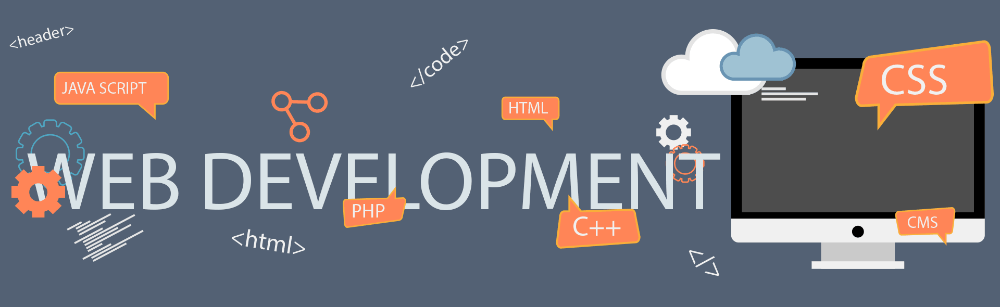

<!-- START HEADER - FULL WIDTH -->

  

<h1 align="center"> 
   
        
</h1> 

<!-- SOCIAL ICONS -->

  
  &nbsp;&nbsp;&nbsp;
  
  &nbsp;&nbsp;&nbsp;
  
  &nbsp;&nbsp;&nbsp;
  
  &nbsp;&nbsp;&nbsp;
  
  &nbsp;&nbsp;&nbsp;
  

---

## 📌 About Me

Results-driven **AI-Driven Web Developer & Software Engineer** with strong expertise in full-stack web applications (`PHP`, `Laravel`, `JavaScript`, `SQL`, `HTML5`, `CSS3`) and enterprise backend system integration. Experienced in configuring inventory modules (PO, GRN, Production) and customizing ERP systems (`Odoo`, `Brain Power ERP`). 

Adept at utilizing modern AI coding assistants (GitHub Copilot, OpenAI API, LLM prompt engineering) to accelerate code generation, optimize complex database queries, and automate workflow logic. Holds a solid foundation in computer science instruction, data engineering, and IT asset governance.

---

## 🛠️ Technical Skills & Core Competencies

- **AI-Driven Tooling:** AI Coding Assistants (Copilot / LLMs), Automated Refactoring, AI Workflow Integration, Prompt Engineering
- **Web Development:** PHP, Laravel (Basic), JavaScript (ES6+), HTML5, CSS3, Bootstrap
- **Database & Data Engineering:** MySQL, Query Optimization, Schema Design, Data Migration, Stored Procedures
- **Enterprise ERP & POS:** Odoo ERP Customization, Brain Power ERP, POS Systems, Inventory Modules (PO, GRN, Production)
- **MIS & Analytics:** Executive MIS Reporting, Inventory Auditing, Data Automation
- **IT Operations & Infrastructure:** Multi-Store IT Support, POS Deployment, Hardware/Network Setup (LAN, Routers, Switches), System Monitoring, User Access Control, Backup Monitoring

---

## 💼 Professional Experience

### **Executive - IT (System Administrator)**
**Fair Group**, Dhaka, Bangladesh | *Nov 2024 – Feb 2026*
- Provided IT support across retail outlets and corporate offices ensuring smooth operations.
- Supported ERP (`Odoo` & `Brain Power ERP`) and POS systems with focus on system stability and usability.
- Troubleshot hardware, software, network, and POS device issues efficiently.
- Monitored system performance and reduced downtime through proactive maintenance.
- Coordinated with vendors and internal teams for system support, SLAs, and upgrades.
- Prepared executive MIS reports on IT operations, incidents, and system performance.
- Assisted ERP development and customization with the implementation team.

### **Lecturer (IT & Computing)**
**Barisal Information Technology College (BITC)** | *Jun 2022 – Oct 2024*
- Delivered practical training on operating systems, networking, and software tools.
- Supported computer lab infrastructure and resolved technical issues.
- Guided students in system-based projects and automation implementations.

### **Web Developer & IT Trainer**
**Next Barisal IT** | *Apr 2019 – Mar 2022*
- Developed dynamic web applications using PHP and Laravel.
- Provided IT training and end-user technical support.
- Managed web application deployment, server hosting, and troubleshooting.

---

## 🚀 Selected Projects

- **Digital Store Management System:** Sales, inventory, and customer data handling platform.
- **Hospital Management System:** Patient records and automated billing workflow software.
- **Admission Management System:** Academic record and admission automation system.
- **[Portfolio Website with Admin Dashboard](https://srahmad.com/)**
- **[Journal Management System](https://biomarifa.com/)**

---

## 🏆 Certifications & Accomplishments

- **Software Engineering Certificate of Accomplishment** – HackerRank ([Verify](https://www.hackerrank.com/certificates/539385f9c36b)) | *2025*
- **SQL (Advanced) Certificate of Accomplishment** – HackerRank ([Verify](https://www.hackerrank.com/certificates/cb9bc4b0617f)) | *2025*
- **SQL (Intermediate) Certificate of Accomplishment** – HackerRank ([Verify](https://www.hackerrank.com/certificates/7b655b6701b0)) | *2025*
- **SQL (Basic) Certificate of Accomplishment** – HackerRank ([Verify](https://www.hackerrank.com/certificates/18652c1d774f)) | *2025*
- **JavaScript (Intermediate) Certificate of Accomplishment** – HackerRank ([Verify](https://www.hackerrank.com/certificates/0d9e7e9898b9)) | *2025*
- **JavaScript (Basic) Certificate of Accomplishment** – HackerRank ([Verify](https://www.hackerrank.com/certificates/793903528142)) | *2025*
- **Certification on Mobile Application Development** – ICT Division, Bangladesh ([Verify](https://meher.logimint.xyz/assets/docs/career/Certificate_of_Mobile_Application_Development.pdf)) | *2022*
- **Certification on Web Application Development** – Bangladesh Hi-Tech Park ([Verify](https://meher.logimint.xyz/assets/docs/career/Certificate_of_Web_Application_Development.pdf)) | *2019*

---

## 🎓 Education

- **B.Sc. in Computer Science & Engineering (CSE)** | National University, Bangladesh (*2021*)  
  *CGPA: 3.43 / 4.00*
- **Higher Secondary Certificate (Science)** | Govt. Mozaharuddin Biswas College (*2016*)  
  *GPA: 3.50 / 5.00*

---

## 🌐 Languages

**Bengali** (Native) | **English** (Fluent) | **Hindi** (Listening Proficiency & Basic Speaking)
